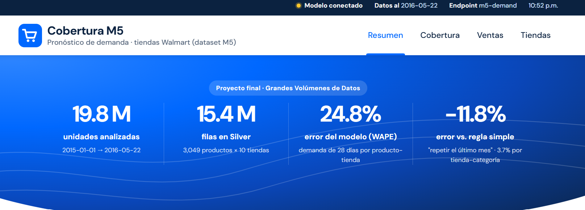
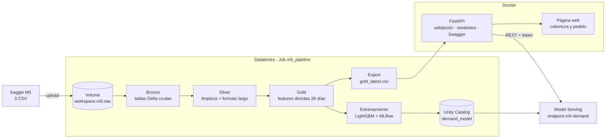
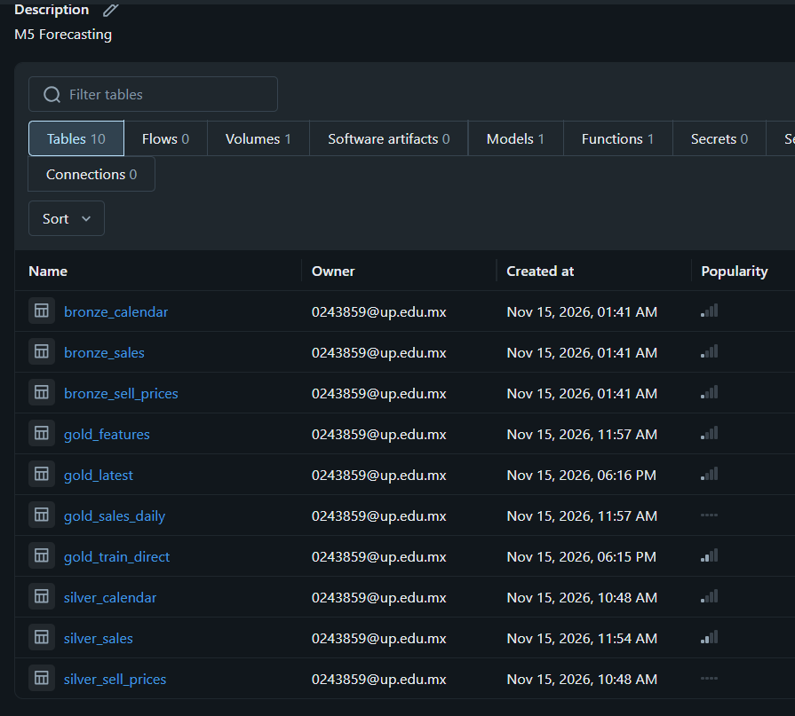
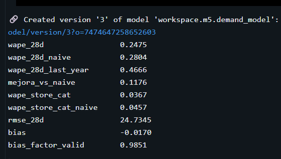
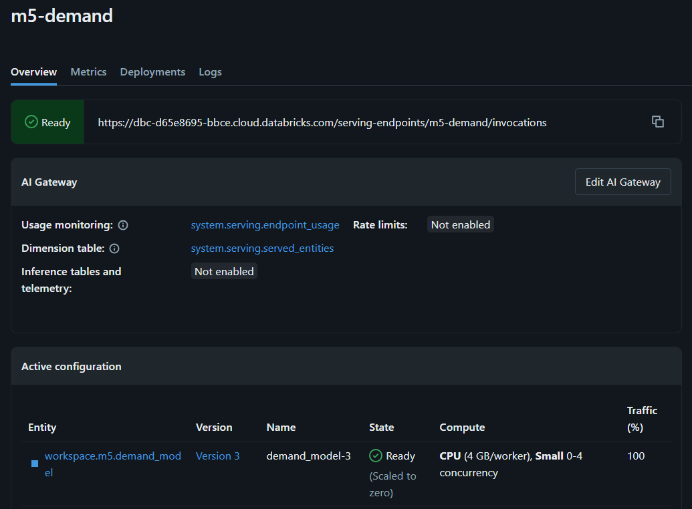
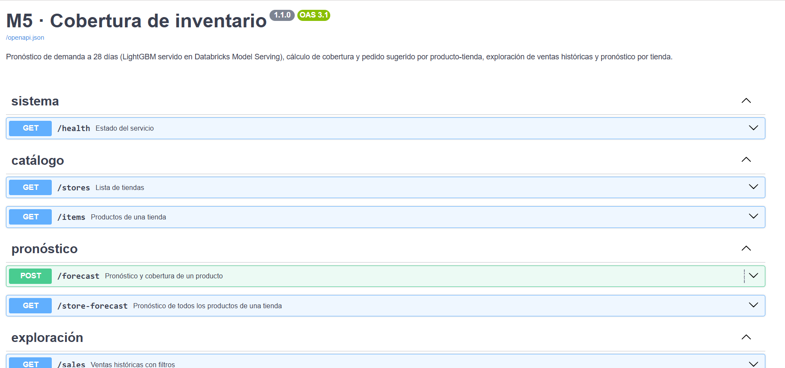
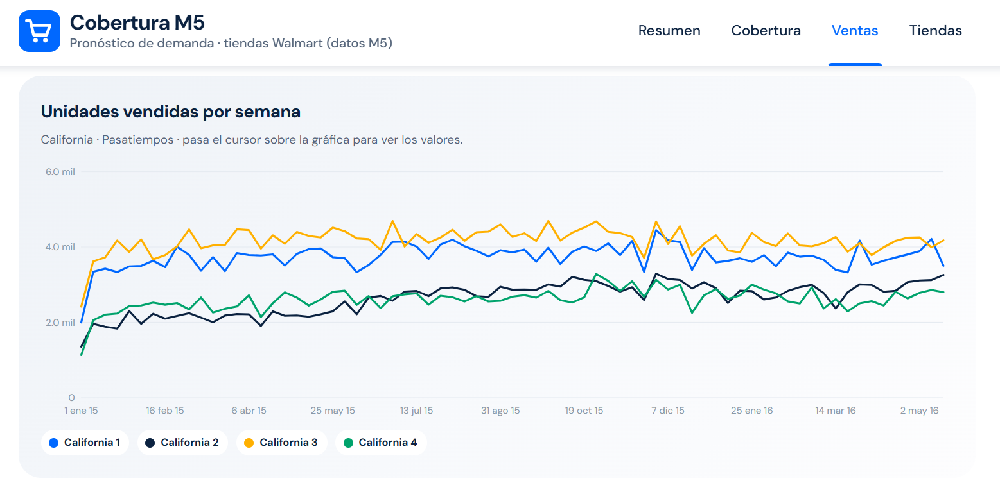
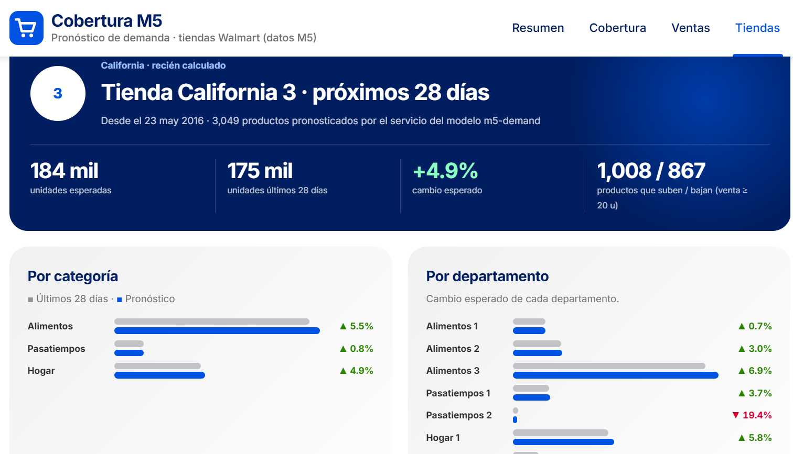
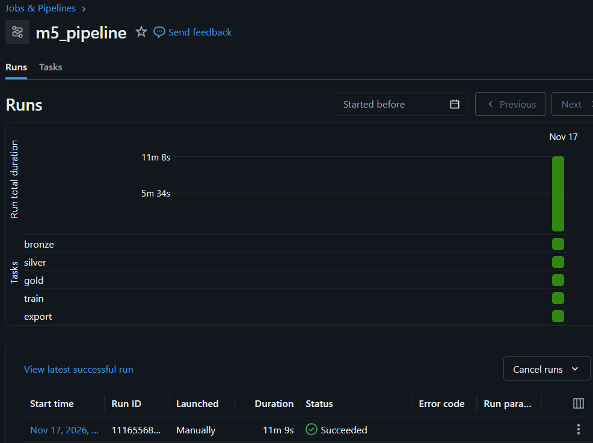
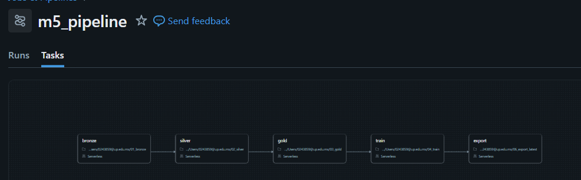

# M5 · Cobertura de inventario con pronóstico de demanda

Pronóstico de demanda a 28 días por producto y tienda (Walmart, dataset **M5**) procesado con **Spark en Databricks** bajo arquitectura **Medallion**, modelo **LightGBM** registrado en **MLflow / Unity Catalog**, publicado como **endpoint de Model Serving**, y consumido por una **API FastAPI + página web** (Docker) que calcula **días de cobertura, punto de reorden y pedido sugerido**.

> Proyecto final · Grandes Volúmenes de Datos · Universidad Panamericana
> Autor: Benjamín García Quintero



---

## Contenido

1. [Problema](#1-problema)
2. [Arquitectura](#2-arquitectura)
3. [Datos y limpieza (Medallion)](#3-datos-y-limpieza-medallion)
4. [Modelo y métricas](#4-modelo-y-métricas)
5. [Publicación del modelo](#5-publicación-del-modelo)
6. [API y página web](#6-api-y-página-web)
7. [Orquestación (Job)](#7-orquestación-job)
8. [Cómo reproducirlo](#8-cómo-reproducirlo)
9. [Estructura del repositorio](#9-estructura-del-repositorio)
10. [Limitaciones y decisiones](#10-limitaciones-y-decisiones)

---

## 1. Problema

Un planeador de inventario necesita responder, para cada producto en cada tienda:

- **¿Cuánto voy a vender en los próximos 28 días?**
- **¿Para cuántos días me alcanza el inventario que tengo hoy?**
- **¿Debo pedir ya? ¿Cuánto?**

Pedir de menos provoca quiebres de stock (venta perdida); pedir de más inmoviliza dinero. La herramienta pronostica la demanda con un modelo de ML y la convierte en decisiones de inventario.

| | |
|---|---|
| **Tipo de tarea** | Regresión (unidades vendidas en los próximos 28 días por producto-tienda) |
| **Métrica principal** | **WAPE** (*Weighted Absolute Percentage Error*) = Σ\|real − pronóstico\| / Σ real |
| **¿Por qué WAPE?** | El **59.8 %** de los registros diarios tienen venta 0 (demanda intermitente). MAPE divide entre cero y es inutilizable; WAPE pondera por volumen, que es lo que importa para inventario. |
| **Métricas secundarias** | RMSE, sesgo (pronóstico total / venta total − 1), WAPE agregado por tienda-categoría |

---

## 2. Arquitectura



| Capa | Tecnología |
|---|---|
| Almacenamiento | Unity Catalog Volume + tablas **Delta** (Parquet por debajo, formato columnar) |
| Procesamiento | **PySpark** en cómputo Serverless |
| Orquestación | **Databricks Job** de 5 tareas encadenadas |
| Modelo | **LightGBM** (objetivo Tweedie), seguimiento en **MLflow**, registro en **Unity Catalog** |
| Publicación | **Databricks Model Serving** (CPU, *scale to zero*) |
| Aplicación | **FastAPI** + página HTML/JS, empaquetadas en **Docker** |

---

## 3. Datos y limpieza (Medallion)

**Fuente:** [M5 Forecasting – Accuracy (Kaggle)](https://www.kaggle.com/competitions/m5-forecasting-accuracy/data) — ventas diarias de 3,049 productos en 10 tiendas de Walmart (California, Texas, Wisconsin), con precios semanales y calendario de eventos. Los datos **no se incluyen** en el repositorio (las reglas de la competencia no permiten redistribuirlos); ver [Cómo reproducirlo](#8-cómo-reproducirlo).



### Bronze — ingesta cruda ([`01_bronze`](notebooks/01_bronze.py))
Los CSV se cargan **tal cual** a Delta (todo como texto) con columnas de auditoría `_ingested_at` y `_source_file`.

| Tabla | Filas | Columnas |
|---|---:|---:|
| `bronze_calendar` | 1,969 | 16 |
| `bronze_sell_prices` | 6,841,121 | 6 |
| `bronze_sales` | 30,490 (formato ancho) | 1,949 |

### Silver — limpieza ([`02_silver`](notebooks/02_silver.py))

| Problema | Decisión | Justificación |
|---|---|---|
| Ventas en formato ancho (1,941 columnas de días) | `unpivot` → 1 fila por producto-tienda-día | Formato necesario para series de tiempo |
| Volumen (~59 M filas) vs. cuota de Free Edition | Solo desde **2015-01-01** | 16+ meses conservan un ciclo anual completo |
| Tipos texto de Bronze | Cast a `date`, `int`, `double` | Tipado correcto para cálculos |
| `calendar.csv` trae 28 días futuros sin ventas | Solo días presentes en ventas | Evita columnas inexistentes |
| Ceros antes de que el producto tuviera precio | **Eliminados** (inner join con precios) | Son ceros estructurales (no se vendía), no demanda cero |
| Nulos en eventos | `"none"` | La ausencia de evento es información |
| Duplicados | `dropDuplicates` por llave | 1 fila por producto-tienda-día |
| Outliers | **Marcados** (`is_outlier`, > p99.9 por producto), no borrados ni modificados | Son picos reales (eventos, promociones) y parte de la demanda; solo 0.08 %. El modelo usa promedios de 7–112 días y objetivo Tweedie, que amortiguan picos aislados |
| Precios ≤ 0 | Filtrados | Precio inválido |

**Resultado:** `silver_sales` con **15,389,479 filas** (2015-01-01 → 2016-05-22), particionada por estado; **59.8 %** de días con venta 0; **12,252** outliers marcados (0.08 %).

### Gold — features ([`03_gold`](notebooks/03_gold.py))
Enfoque **directo**: para cada producto-tienda y una fecha de corte (*origen*) se calculan features **solo con datos anteriores al origen** y el objetivo es la **venta total de los 28 días siguientes**.

| Grupo | Features |
|---|---|
| Demanda reciente | promedios de 7, 14, 28, 56 y 112 días · desviación de 28 días |
| Intermitencia | fracción de días sin venta (28 y 112 días) · días desde la última venta |
| Estacionalidad | venta del mismo periodo del año anterior · mes |
| Precio (normalizado) | precio actual · precio / su histórico · cambio vs. hace 28 días |
| Calendario del horizonte | días SNAP del estado · días con evento (se conocen por adelantado) |
| Jerarquía (codificada) | producto, departamento, categoría, tienda, estado → índice entero |

| Tabla | Filas | Uso |
|---|---:|---|
| `gold_train_direct` | 3,765,594 (124 orígenes) | Entrenamiento |
| `gold_latest` | 30,490 | Features "al día de hoy" que consulta la API |
| `gold_sales_daily` | — | Ventas y venta en $ por día, tienda y categoría |
| `gold_features` | — | Features del modelo diario (v1–v2); se conserva como evidencia de la primera iteración |

**Sin fuga de información:** todas las ventanas terminan el día **anterior** al origen (`rangeBetween(-k, -1)`).

**Nulos en Gold:** `ly28` (venta del mismo periodo del año anterior) queda vacío cuando el producto no tiene un año de historia, y `price_chg28` cuando no había precio 28 días antes. No se imputan: LightGBM maneja los valores faltantes de forma nativa (aprende hacia qué rama mandarlos), y rellenarlos con 0 le diría al modelo que "no vendió nada", lo cual es falso.

---

## 4. Modelo y métricas

[`04_train`](notebooks/04_train.py) — **LightGBM** con objetivo **Tweedie** (pensado para conteos con muchos ceros).

**Validación temporal (sin fuga):**
`train` (orígenes cuyo horizonte termina antes de validación) → `valid` (origen 2016-03-28: early stopping y elección de `tweedie_variance_power` ∈ {1.1, 1.3, 1.5}) → **`test`** (origen **2016-04-25**, últimos 28 días, nunca vistos; solo para reportar). El modelo final se reentrena con todos los orígenes previos al test.

### Resultados en el periodo de prueba (versión 3 registrada)

| Métrica | Valor |
|---|---:|
| **WAPE 28 días por producto-tienda** | **0.2475** |
| Línea base: promedio últimos 28 días × 28 | 0.2804 |
| Línea base: mismo periodo del año anterior | 0.4666 |
| **Mejora vs. línea base más exigente** | **11.8 %** |
| WAPE por tienda-categoría (modelo / base) | **3.7 %** / 4.6 % |
| Sesgo | −1.7 % |
| RMSE (unidades en 28 días) | 24.7 |



**Variables más importantes:** promedios recientes (28, 14, 56, 112 y 7 días), días desde la última venta y precio — la demanda reciente manda; la intermitencia y el precio ajustan.

### Cómo llegamos aquí (iteraciones registradas en MLflow)

| Versión | Enfoque | WAPE 28 días | Nota |
|---|---|---:|---|
| v1–v2 | Pronóstico **diario** con lags ≥ 28 días, sumado a 28 días | 0.2785 | Casi empataba con la línea base exigente: sus features más recientes tenían hasta 28 días de antigüedad |
| **v3** | Pronóstico **directo** del total de 28 días | **0.2475** | 11 % menos error que v2; sesgo de −7 % a −1.7 % |

También se probaron (sin mejora significativa): más datos de entrenamiento, codificación del promedio histórico por producto, un modelo por tienda, orígenes diarios, ensamble de modelos y 6 combinaciones de hiperparámetros.

---

## 5. Publicación del modelo



| | |
|---|---|
| Modelo | `workspace.m5.demand_model` · versión **3** |
| Endpoint | **`m5-demand`** · CPU Small · *scale to zero* |
| URL | `https://<tu-workspace>.cloud.databricks.com/serving-endpoints/m5-demand/invocations` |
| Entrada | 21 features numéricas (firma MLflow validada por el endpoint) |
| Salida | unidades pronosticadas para los próximos 28 días |

**Consulta desde PowerShell** (como en clase), con las features reales de **FOODS_3_090 en la tienda CA_3** (las imprime el notebook [`05_query_endpoint`](notebooks/05_query_endpoint.py)):

```powershell
$token = "<TU_TOKEN>"
$url   = "https://<tu-workspace>.cloud.databricks.com/serving-endpoints/m5-demand/invocations"
$body  = @{ dataframe_records = @(@{
  item_id_idx=702.0; dept_id_idx=2.0; cat_id_idx=0.0; store_id_idx=2.0; state_id_idx=0.0;
  m7=95.71428571428571; m14=114.85714285714286; m28=119.89285714285714; m56=115.125; m112=112.5625;
  std28=34.893848853783496; zf28=0.0; zf112=0.0; days_since_sale=1.0; ly28=1174.0;
  price=1.6; price_norm=1.110473536082186; price_chg28=0.0; snap_days=10.0; event_days=4.0; month=5.0 }) } | ConvertTo-Json -Depth 3
Invoke-RestMethod -Method Post -Uri $url -Headers @{Authorization="Bearer $token"} `
  -ContentType "application/json" -Body $body
```

**Con curl:**

```bash
curl -X POST "https://<tu-workspace>.cloud.databricks.com/serving-endpoints/m5-demand/invocations" \
  -H "Authorization: Bearer <TU_TOKEN>" -H "Content-Type: application/json" \
  -d '{"dataframe_records":[{"item_id_idx":702.0,"dept_id_idx":2.0,"cat_id_idx":0.0,"store_id_idx":2.0,"state_id_idx":0.0,"m7":95.71428571428571,"m14":114.85714285714286,"m28":119.89285714285714,"m56":115.125,"m112":112.5625,"std28":34.893848853783496,"zf28":0.0,"zf112":0.0,"days_since_sale":1.0,"ly28":1174.0,"price":1.6,"price_norm":1.110473536082186,"price_chg28":0.0,"snap_days":10.0,"event_days":4.0,"month":5.0}]}'
```

Respuesta: `{"predictions": [2894.8...]}` → **≈ 2,895 unidades** en los próximos 28 días (vendió 3,357 en los últimos 28: el modelo detecta que la última semana viene más baja).

---

## 6. API y página web

El endpoint de Databricks recibe 21 features numéricas, algo que un usuario no puede capturar. La **API FastAPI** ([`api/app/main.py`](api/app/main.py)) traduce una pregunta de negocio (tienda, producto, inventario) en la petición al modelo y convierte el pronóstico en decisiones.

| Ruta | Descripción |
|---|---|
| `POST /forecast` | Pronóstico 28 días + cobertura + punto de reorden + pedido sugerido |
| `GET /store-forecast` | Pronóstico de **todos** los productos de una tienda (llamadas por lote de 1,000 filas al endpoint, caché de 6 h) |
| `GET /sales` | Ventas históricas de `gold_sales_daily` con filtros (estado, tienda, categoría, fechas), métrica, periodo y agrupación |
| `GET /stores` · `GET /items` | Catálogo para los selectores |
| `GET /health` | Estado (features cargadas, credenciales) |
| `GET /docs` | **Swagger / OpenAPI** generado automáticamente |



**Validación de entradas** (Pydantic): formato de tienda (`CA_1`…`WI_3`) y producto (`FOODS_3_090`), inventario ≥ 0, lead time 0–60 días, días a cubrir 1–56, nivel de servicio 90/95/98/99 %. Una entrada inválida responde **422** con el campo y el motivo.

**Manejo de errores al consumir el endpoint** (probado con un simulador de Databricks):

| Situación | Respuesta de la API |
|---|---|
| *Cold start* del endpoint (503/429/504) | Reintenta automáticamente una vez |
| Tiempo de espera agotado | 504 con mensaje "espera 1–2 minutos" |
| Respuesta sin `predictions` / valor negativo, NaN o infinito | 502 "respuesta inválida del modelo" |
| Token inválido o vencido | 502 indicando revisar credenciales |
| Producto o tienda inexistente | 404 |
| Databricks no disponible al arrancar | Reintenta la carga de features en la siguiente petición |

**Página web** (`/`), con estilo de tablero corporativo (barra de estado del modelo, banda de KPIs y tarjetas por tienda) y cuatro pestañas:

| Pestaña | Qué hace | Filtros |
|---|---|---|
| **Resumen** | KPIs del proyecto (volumen, error del modelo), flujo Bronze → Silver → Gold → modelo → endpoint, y ventas de la última semana por tienda (clic → su pronóstico) | — |
| **Cobertura por producto** | Consulta al modelo para un producto: demanda 28 días, días de cobertura, fecha estimada de quiebre, punto de reorden y pedido sugerido | Tienda, producto, inventario, lead time, días a cubrir, nivel de servicio |
| **Ventas históricas** | Exploración de la capa Gold: gráfica interactiva (valores al pasar el cursor) y KPIs del periodo | Estado, tienda, categoría, rango de fechas, unidades o $, día/semana/mes, comparar por categoría/tienda/estado |
| **Pronóstico por tienda** | Pronostica los ~3,000 productos de una tienda: demanda esperada, cambio por categoría y departamento, ranking de productos que más suben o bajan; clic en un producto → su cobertura | Tienda, categoría, orden, venta mínima, búsqueda |





En todas: validación antes de enviar, límite de espera, aviso cuando el modelo está "despertando" y mensajes claros ante cualquier error. Funciona en celular y en modo oscuro.

**Lógica de inventario:**
- Stock de seguridad = z(nivel de servicio) · σ diaria · √(lead time + días a cubrir)
- Punto de reorden = demanda diaria × lead time + stock de seguridad
- Riesgo **alto** si el inventario se agota antes de que llegue un pedido; **medio** si ya cruzó el punto de reorden; **bajo** en otro caso.
- Se sugiere pedir solo al cruzar el punto de reorden: cantidad = demanda × (lead time + días a cubrir) + seguridad − inventario.

---

## 7. Orquestación (Job)

Job **`m5_pipeline`** en Databricks con 5 tareas encadenadas en cómputo Serverless y un disparador programado semanal (en pausa para cuidar la cuota de Free Edition):

```
bronze → silver → gold → train → export
```





Cada ejecución registra una nueva versión del modelo en MLflow; el endpoint sigue sirviendo la versión elegida hasta que se actualiza manualmente (*Serving → Edit*), lo que evita publicar un modelo sin revisarlo.

---

## 8. Cómo reproducirlo

### A. Databricks
1. Descargar de [Kaggle](https://www.kaggle.com/competitions/m5-forecasting-accuracy/data) (aceptando las reglas): `calendar.csv`, `sales_train_evaluation.csv`, `sell_prices.csv`.
2. En **Catalog → workspace**: crear el schema `m5` y el Volume `raw`; subir los 3 CSV.
3. Importar los notebooks de [`notebooks/`](notebooks) y crear el Job con las tareas `01 → 02 → 03 → 04 → 06` (o correrlos en orden).
4. **Serving → Create serving endpoint**: nombre `m5-demand`, modelo `workspace.m5.demand_model` (última versión), CPU Small, *scale to zero*.
5. (Opcional) `05_query_endpoint` para probar el endpoint.
6. **Settings → Developer → Access tokens** → generar un token.

### B. API y página (Docker en WSL/Linux)
```bash
git clone https://github.com/<usuario>/m5-cobertura.git
cd m5-cobertura
cp api/.env.example api/.env      # llenar DATABRICKS_HOST y DATABRICKS_TOKEN
docker compose up --build
```
- Página: **http://localhost:8001**
- Swagger: **http://localhost:8001/docs**

Al arrancar, la API descarga `gold_latest.csv` y `gold_sales_daily.csv` del Volume con el mismo token. La primera consulta puede tardar 1–2 minutos si el endpoint estaba en reposo (*scale to zero*).

<details>
<summary>Sin Docker (Python 3.12+)</summary>

```bash
cd api
python3 -m venv .venv && source .venv/bin/activate
pip install -r requirements.txt
set -a; source .env; set +a
uvicorn app.main:app --port 8001
```
</details>

---

## 9. Estructura del repositorio

```
m5-cobertura/
├── notebooks/
│   ├── 01_bronze.py           # CSV → Delta crudo
│   ├── 02_silver.py           # limpieza, tipos, unpivot, outliers
│   ├── 03_gold.py             # features directas 28 días + gold_latest
│   ├── 04_train.py            # LightGBM + MLflow + registro en UC
│   ├── 05_query_endpoint.py   # prueba del endpoint publicado
│   └── 06_export_latest.py    # gold_latest y gold_sales_daily → CSV para la API
├── api/
│   ├── app/
│   │   ├── main.py            # FastAPI: validación, consumo del endpoint, lógica de inventario, ventas
│   │   └── static/index.html  # página web (3 pestañas, gráficas SVG sin librerías externas)
│   ├── Dockerfile
│   ├── requirements.txt       # versiones fijas
│   ├── .env.example           # plantilla (el .env real no se sube)
│   └── app.yaml               # configuración opcional para Databricks Apps
├── docker-compose.yml
└── docs/img/                  # capturas
```

---

## 10. Limitaciones y decisiones

- **Fecha de referencia:** el dataset termina el 2016-05-22; la app trata **2016-05-23** como "hoy".
- **Databricks Free Edition:** cuota diaria de cómputo; por eso se usa desde 2015, el disparador semanal está en pausa y el endpoint usa *scale to zero* (a cambio de un *cold start* de 1–2 minutos, manejado por la API y la página).
- **Error irreducible:** muchos productos venden pocas piezas al mes; parte del error es azar puro. El modelo mejora 11.8 % a la línea base exigente a nivel producto-tienda y llega a 3.7 % de error a nivel tienda-categoría.
- **Seguridad:** el token nunca se sube al repositorio (`.env` en `.gitignore`); se comparte por canal privado.
- **Precio futuro:** el modelo usa el precio actual; no simula promociones futuras.
